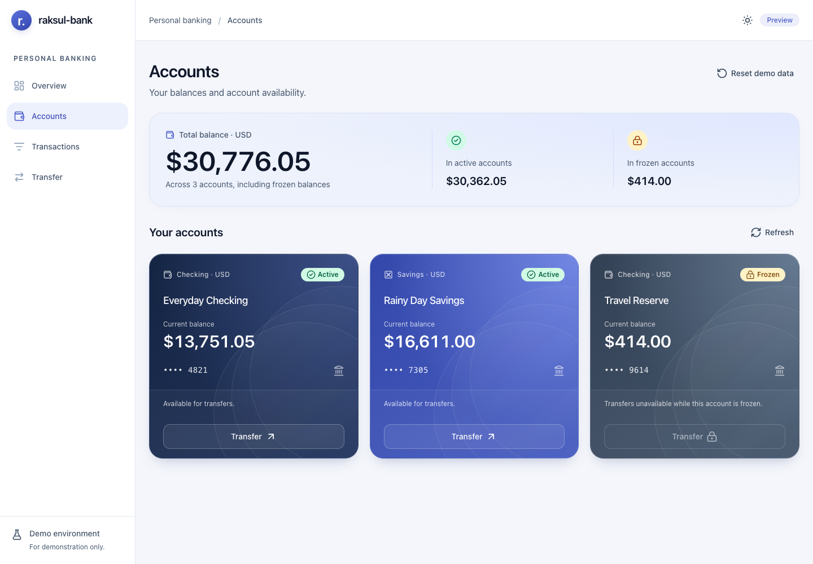
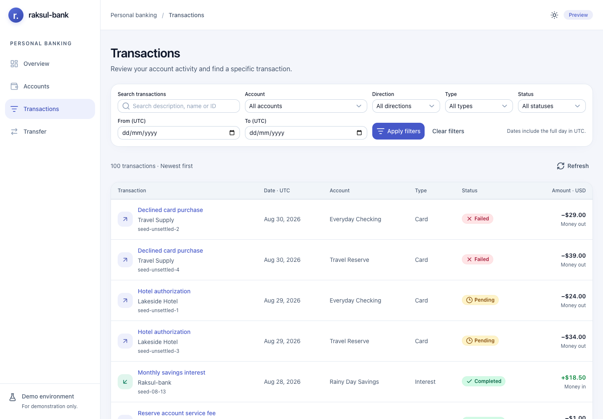
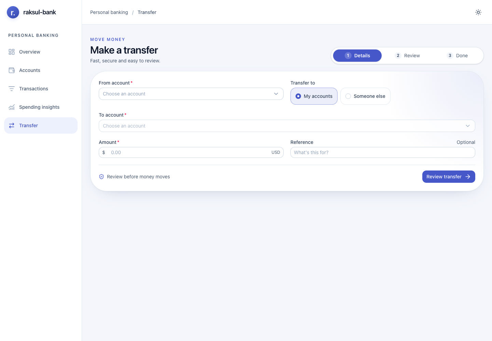
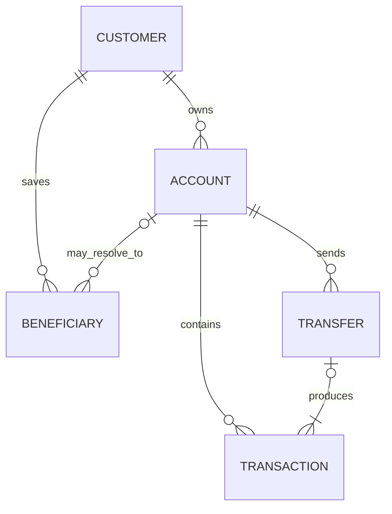

# Raksul-bank

A customer-facing banking dashboard built with Nuxt 4, Vue 3 and strict TypeScript. The demo covers account overview, transaction discovery and consistent transfers without requiring a backend or API key.

**Reviewer path:** [run locally](#getting-started) · [architecture](#architecture-overview) · [acceptance evidence](docs/verification.md)

https://github.com/user-attachments/assets/4a32ad51-f665-4a94-a8b0-40082cc50e54

## Highlights

- Browse owned accounts and realistic activity with responsive filters, pagination and transaction details.
- Transfer between accounts or to saved/new recipients with exact integer-cent arithmetic, validation and clear outcome handling.
- Keep balances, linked activity and idempotency records consistent in one validated IndexedDB transaction.
- Exercise the typed API boundary through browser MSW, use cases and IndexedDB.

Transfers are fictional and no real funds or customer data are involved.

## Product tour

### Accounts at a glance



### Searchable transaction activity



### Guided transfer flow



## Deliberately Left Out

Real authentication, authorization, OTP/MFA, currency conversion, fees, scheduled transfers, overdraft, payment rails, settlement, fraud detection and ledger reconciliation are outside this demo's scope. There is no implemented production banking backend or real customer data.

## Technology Stack

Nuxt 4 (SSR with Nitro), Vue 3, strict TypeScript, Nuxt file-based routing (Vue Router 5), Nuxt UI 4, Tailwind CSS 4, TanStack Vue Query, Zod, MSW and IndexedDB. Tests use Vitest, Vue Test Utils, fake-indexeddb and Playwright/Chromium.

Dependencies are pinned in `package-lock.json`. Nuxt owns application startup, routing, layouts, head metadata and server rendering. Vite is used internally by Nuxt and separately for isolated component tests.

## Getting Started

Use Node.js 24.14.0 (pinned in `.nvmrc`) and npm 11.

```bash
nvm install
nvm use
npm ci
npm run dev
```

Open the URL printed by Nuxt, normally `http://127.0.0.1:3000`. `npm ci` runs `nuxt prepare` to generate Nuxt types.

To preview the production Node/Nitro server:

```bash
npm run build
npm run preview
```

No API keys, environment variables or database server are required. The application is intentionally mock-only: Nuxt renders the shell and loading states on the server, then the browser starts MSW and reads fictional data from IndexedDB. Direct server requests to `/api/*` fail closed instead of being forwarded.

See [Nuxt migration and future backend handoff](docs/nuxt-migration.md) for the runtime boundary and requirements that would apply if a real backend is added later.

## Available Scripts

| Command                  | Purpose                                            |
| ------------------------ | -------------------------------------------------- |
| `npm run dev`            | Start the local development server.                |
| `npm run build`          | Typecheck and build Nitro into `.output/`.         |
| `npm run preview`        | Preview the production server locally.             |
| `npm run typecheck`      | Check application and tooling types.               |
| `npm run lint`           | Run ESLint.                                        |
| `npm run check:links`    | Check local links in reviewer-facing project docs. |
| `npm run format:check`   | Check Prettier formatting.                         |
| `npm run test -- --run`  | Run the unit/component suite once.                 |
| `npm run test:e2e`       | Build and run Chromium mock-demo checks.           |
| `npm run test:e2e:built` | Run Chromium checks against an existing build.     |
| `npm run test:all`       | Run unit tests, build and browser checks.          |
| `npm start`              | Run `.output/server/index.mjs` in deployment.      |

## Architecture Overview

```text
Nuxt UI → typed API client → browser MSW → use case → repository port → IndexedDB
```

## Project Structure

| Directory                          | Responsibility                                                                                |
| ---------------------------------- | --------------------------------------------------------------------------------------------- |
| `src/app.vue`, `src/app.config.ts` | Nuxt root and UI theme configuration.                                                         |
| `src/layouts/`, `src/plugins/`     | Nuxt layout plus mock/API and query-cache startup.                                            |
| `server/api/`                      | Fail-closed response for requests that were not intercepted in the browser.                   |
| `src/pages/`                       | Nuxt file-based route pages.                                                                  |
| `src/features/`                    | Account, transaction and transfer UI/queries, recent activity and demo reset.                 |
| `src/contracts/`                   | Shared API/query types and the public banking client interface; no implementation imports.    |
| `src/domain/`                      | Banking entities, money, masking and pure transfer rules.                                     |
| `src/use-cases/`                   | Repository contract, customer scoping, transaction queries and atomic transfer orchestration. |
| `src/data/`                        | HTTP client, MSW handlers, seed, persistence validation and IndexedDB adapter.                |
| `src/shared/`                      | Theme, async states, money display and masked account numbers.                                |
| `src/tests/`                       | Domain, data/API and component tests.                                                         |
| `docs/adr/`                        | Architecture decision records.                                                                |

MSW translates HTTP requests and responses. Use cases own customer scoping and filtering. Vue components do not import repositories or seed data. Domain code is independent of Vue, HTTP and persistence. ESLint checks these import boundaries.

Shared query/response shapes live in `src/contracts/transactions.ts`; pagination metadata lives in `src/contracts/pagination.ts`. API clients, use cases and UI import those types directly from their defining modules. `src/contracts/banking.ts` defines the public `BankingApi` interface, implemented by the HTTP factory and used by the injected context. Contracts use type-only imports from domain/other contracts. Domain entities stay in `domain/`; privileged persistence state stays with the repository port. `ApiError` belongs to `data/api/apiError.ts`, so UI and SSR payload handling do not import the HTTP factory just to identify errors. Do not re-export contracts through client or use-case implementations.

## Data Model

The seed contains one fictional customer, three owned accounts (active checking, active savings and frozen checking), three hidden internal recipient accounts, six saved beneficiaries, 100 transactions across March–August 2026 and six completed own-account transfers. Jordan Lee is a separate same-bank directory record, deliberately not a saved beneficiary.

| Entity              | Main fields and relationships                                                                                                                                                             |
| ------------------- | ----------------------------------------------------------------------------------------------------------------------------------------------------------------------------------------- |
| Customer            | ID and names; owns accounts and beneficiaries.                                                                                                                                            |
| Account             | ID, owner, display name, type, account number, USD currency, balance in cents, active/frozen status and creation timestamp.                                                               |
| Transaction         | ID, account ID, optional transfer ID, direction, type, positive amount in cents, currency, status, description, counterparty and timestamp.                                               |
| Beneficiary         | ID, customer ID, name, bank, account number, currency and optional internal account ID.                                                                                                   |
| TransferDestination | An owned account, an internal recipient account with a recipient snapshot, or an external recipient snapshot.                                                                             |
| Transfer            | ID, idempotency key, request hash, source, destination, amount, currency, reference, status and timestamps. Completed transfers retain the request fingerprint and recipient destination. |



The diagram shows the demo's current customer and its account ownership projection. Hidden recipient accounts have owner IDs outside that customer. A transfer destination is either an account reference or an immutable recipient snapshot; historical transfers do not depend on a beneficiary's current name. Non-transfer card/cash/fee/interest activity has no transfer ID. The persisted snapshot includes hidden accounts, but customer API projections exclude them.

Money uses safe integer minor units: `$10.50` is `1050` cents. Transaction direction supplies the debit/credit sign. Aggregate balances use BigInt, and formatting preserves exact cents. Account numbers are masked in the visible UI.

Seed balances reconcile to fixed opening balances plus completed activity. Pending and failed entries do not change balances. Total balance includes frozen accounts; active and frozen balances are shown separately. There is no holds or overdraft model.

## Mock API and Persistence

| Method | Endpoint                     | Response                                            |
| ------ | ---------------------------- | --------------------------------------------------- |
| GET    | `/api/customer`              | Current customer.                                   |
| GET    | `/api/accounts`              | Customer-owned accounts, including frozen accounts. |
| GET    | `/api/accounts/:accountId`   | Owned account or 404.                               |
| GET    | `/api/transactions`          | Filtered activity and pagination.                   |
| GET    | `/api/beneficiaries`         | Current customer's beneficiaries.                   |
| POST   | `/api/beneficiaries`         | Save or return an existing USD recipient.           |
| POST   | `/api/transfers`             | Completed receipt; requires an idempotency key.     |
| GET    | `/api/transfers/:transferId` | Customer-scoped completed receipt or 404.           |
| POST   | `/api/demo/reset`            | 204 after restoring the seed.                       |

Transaction queries accept `accountId`, `query`, `direction`, `type`, `status`, `dateFrom`, `dateTo`, `page` and `pageSize`. Dates are inclusive UTC calendar dates. Results are scoped before filtering/counting and sorted newest first. Pagination defaults to 20 entries; the maximum page size is 100.

The client passes cancellation signals to fetch and surfaces structured API errors. In demo mode, MSW starts after hydration and before API queries are enabled. Mock responses use randomized, operation-specific latency from 1–3 seconds so loading, refresh and processing states remain visible; automated tests skip this delay. Unhandled `/api/` requests fail visibly. Successful response types are trusted contracts of the controlled mock API, not independently validated client payloads.

### Persistence

The IndexedDB database `raksul-bank` stores one versioned snapshot in object store `banking-state`, key `current`. It includes the customer, accounts, transactions, transfers and beneficiaries. Zod validates its structure and relationships.

The return to the `raksul-bank` name intentionally starts a fresh fictional demo for browsers that previously used `personal-finance-lab` or `personal-banking-lab`. Those disposable older namespaces and recovery records are not migrated; they can be removed through the browser's site-data controls.

The repository initializes missing data and recovers structurally invalid or incompatible snapshots to the seed. Read/open failures surface without resetting data. Write failures and transaction aborts preserve the previous committed state. A newer database version produces an open error instead of being deleted.

`load()`, `update(change)` and `reset()` are asynchronous. An update reads the latest snapshot and applies a synchronous callback within one IndexedDB readwrite transaction; it resolves only after commit. Power-loss durability and storage retention depend on the browser; users can edit or clear local data. The callback must use that snapshot for checks and must not perform network or storage side effects. IndexedDB serializes these transactions across connections to the same object store.

## Transaction Explorer

Open Transactions to browse activity, newest first. Search matches descriptions, counterparties and transaction IDs. Combine it with account, direction, type, status and date filters, then select **Apply filters**. **Clear filters** restores all activity. Frozen accounts remain available for reviewing past activity.

Applied filters and pagination live in the URL; refreshing, sharing the link and Back/Forward restore that view. The form holds only unapplied edits. Applying filters or changing page size returns to page 1. The UI renders the API page directly without filtering or paginating a local copy of the dataset.

Select a transaction description to open its details: full UTC timestamp, signed amount, direction, type, status, masked account, counterparty, description/reference and any transfer ID. The drawer uses the loaded activity, adds no API request, keeps keyboard focus inside, and returns focus to its trigger when closed with Escape or Close. It preserves the current filters/page; it is not a separate permalink or a stored running-balance view.

The page distinguishes initial loading, API errors with retry, an empty dataset, no matching results and an out-of-range page. Invalid URL values require correction before fetching transactions. Desktop uses a table; smaller screens use stacked activity rows with signed, right-aligned amounts and explicit direction/status labels.

## State Management

Applied transaction filters and pagination belong to Vue Router query parameters. Unapplied filters and the current transfer stage are local Vue state; transfer details/review/retry context are also persisted in browser-local recovery storage; UForm and Zod handle form validation. There is no Pinia store or duplicate authoritative account cache.

TanStack Vue Query manages API state with a 30-second stale time, one query retry and no mutation retries. Reset cancels in-flight banking queries, awaits persistence and invalidates the cache. Committed demo mutations notify other tabs on the same origin to cancel stale queries and refetch. Cross-device persistence is deferred.

## Transfer Semantics

| Destination                          | Source balance  | Destination balance               | Resulting activity                                                    |
| ------------------------------------ | --------------- | --------------------------------- | --------------------------------------------------------------------- |
| My own active account                | Debited         | Credited                          | Two entries sharing one transfer ID                                   |
| Saved internal recipient             | Debited         | Hidden recipient account credited | Linked debit/credit; only the owned debit is visible to this customer |
| Saved external recipient             | Debited         | Outside this system               | One source debit and a stored recipient snapshot                      |
| Rejected validation or aborted write | Unchanged       | Unchanged                         | No new transfer or activity                                           |
| Same idempotency key and payload     | No second debit | No second credit                  | Original result is returned                                           |

Open **Transfer**, choose an active source, then **My accounts** or **Someone else**. Select or enter a destination, enter a plain USD decimal amount and an optional reference (up to 140 characters), then select **Review transfer**. Review is read-only and displays masked account numbers, recipient/bank, balance, currency, amount and reference. Only **Confirm transfer** writes data. For a new recipient, **Save recipient for next time** is unchecked by default. If selected, confirmation saves the beneficiary and transfer atomically; otherwise only the transfer and its recipient snapshot are persisted. The receipt shows the committed transfer ID and UTC completion time, with links to activity and accounts.

Choose **Someone else**, select **Same bank** or **Other bank**, then use **Saved recipient** to search contacts in that network. Switching networks clears the previous selection. Search saved contacts by name, bank or last four account digits. The selection shows the bank and masked account number and is restored when returning from Review or reloading a draft. Choose **Enter a new recipient** to use the manual form. Successfully saved contacts appear in this selector for future transfers; unsuccessful transfers never add a contact.

Entering **Someone else** prefills an unsaved same-bank recipient (Jordan Lee, `200000008319`). Switching to **Other bank** prefills the unsaved Avery Stone at Techcombank (`987654327451`) so the save-recipient flow can be demonstrated. These fields remain editable; restored drafts take precedence and amounts are not prefilled. Same-bank entry still requires **Check account**.

For a quick same-bank demo, select **Alex Rivera** from saved recipients, or use the prefilled, unsaved Jordan Lee account number `200000008319` and choose **Check account**. Jamie Park uses `200000006027`. Same-bank **Check account** calls `GET /api/recipient-accounts/:accountNumber`, which looks up active third-party accounts independently of saved contacts and returns only recipient name, bank, number and currency. Jordan Lee is not saved in the seed: transfer once with or without **Save recipient for next time** to try both paths. Existing local snapshots gain this account without resetting balances or history. It is a fictional directory, not a real bank verification service. External accounts are identified by bank plus account number, so a number matching a Raksul-bank account at another bank remains external.

Own-account and saved internal-recipient transfers debit the source, credit the destination and create linked debit/credit activity. External recipients receive a stored recipient snapshot and one source debit; there is no external balance or real settlement. Hidden recipient accounts never appear in customer account/activity queries.

`executeTransfer` prepares a SHA-256 fingerprint of the normalized request, then resolves or creates the recipient, checks idempotency, validates balances and applies the beneficiary, balance, activity and receipt changes inside one synchronous repository update callback. It returns only after the IndexedDB transaction commits. Failed validation or persistence leaves the entire previous state intact, including the beneficiary list. Concurrent requests use the latest committed balance. The same key and payload return the earlier result; changing the payload with a used key returns a conflict. Reset clears transfers and their idempotency records along with the rest of the demo.

`POST /api/beneficiaries` accepts `displayName`, `bankName`, `accountNumber` (8–20 digits), and `currency: "USD"`. Internal recipient accounts must exist; external details are simulated. Saving does not transfer funds.

`POST /api/transfers` accepts `idempotencyKey`, `sourceAccountId`, `destination`, `amountMinor`, `currency: "USD"` and optional `reference`. Destination is `{ kind: "OWN_ACCOUNT", accountId }`, `{ kind: "BENEFICIARY", beneficiaryId }`, or `{ kind: "NEW_BENEFICIARY", beneficiary, saveRecipient }`; recipient snapshots are resolved by the use case. The UI always sends explicit `saveRecipient: true` or `false` for new recipients. Omission retains the earlier save-by-default behavior for existing clients and recovery records; explicit `true` preserves their fingerprint. Changing this choice with an already-used key returns a conflict. The key is a nonblank string of at most 128 characters. Requests reject unknown fields, unsafe/fractional minor units and unavailable accounts/recipients. Responses omit the stored key and fingerprint. Invalid payloads return 400, domain validation 422, key conflicts 409, missing receipts 404 and storage failures 503.

The mutation never automatically retries. Confirmation is guarded against double clicks, and successful completion invalidates account/activity caches. A definite validation rejection explains that no money moved and refreshes the available balance. An `IDEMPOTENCY_CONFLICT` is terminal for that request: Review replaces confirmation with **Check transaction activity**, allows navigation/editing, and preserves the conflict on reload. It never retries or generates a replacement key automatically. Network, storage or ambiguous errors do not claim failure or success: review retains the exact request/key for an explicit safe retry, blocks in-app navigation and warns before unloading. The browser saves drafts and immutable retry requests before confirmation. After forced close/reload, opening Transfer restores the saved context for explicit same-key retry; no payment is sent automatically. Inaccessible recovery storage blocks new confirmations. Reset clears demo recovery records. Committed balances/activity persist across reloads, and receipts remain retrievable through the API. A production integration still needs server-backed recovery, session/privacy controls and backend-enforced idempotency/authorization.

## Assumptions and Engineering Notes

- The demo assumes one already authenticated fictional customer. It implements no login or server-side authorization; masking is presentation only, and full fictional numbers remain in API/storage data.
- Transfers use USD, execute within one request and await storage commit. There are no fees, exchange rates, holds, overdraft or asynchronous settlement. External destination balances are outside this system.
- Safe integer cents are authoritative; BigInt is used for aggregate display. Decimal text is parsed without floating-point rounding.
- IndexedDB gives atomic, serialized local updates. Committed writes notify same-origin demo tabs to refetch; cross-device persistence is deferred. Browser retention and durability are not production database guarantees.
- A future real backend must add authentication, authorization, ownership checks, idempotency and transactional consistency; none are implied by this browser demo.

## Testing

See the [requirement-by-requirement acceptance evidence](docs/verification.md) for the final review and verified checks.

See [Testing strategy](docs/testing.md) for the automated unit, component and Chromium suites.

The unit/component suite covers domain, data/API and UI behavior. Run `npm run test -- --run`, then `npm run build && npm run test:e2e:built` for the built mock-only application.

Coverage includes exact money conversion and bounds, transfer validation, masking, deterministic seed reconciliation, ownership scoping, query validation/filtering, persistence reload/reset, corruption recovery, rollback, concurrent updates, API errors, and UI loading/error/retry/empty/reset states. Transaction tests also cover combined filters through HTTP, URL restoration, Back/Forward, pagination, invalid dates/URLs, empty results, retry and stale-response isolation. Isolated component tests render real Nuxt UI components with Vue Router, Vue Query and MSW, using a small Nuxt routing/metadata adapter. Browser checks run the built Nuxt application with no mode environment overrides.

Manual browser checks cover desktop/tablet/mobile layouts, navigation, reset, native IndexedDB/API integration and large-balance wrapping. Transfer integration tests exercise the real form, HTTP handlers and IndexedDB adapter (fake-indexeddb), including lost-response replay and concurrent balance checks. Native browser verification covers successful transfers, persisted balances/activity and reset.

See [enhancement behavior and verification commands](docs/enhancements.md) for recipients, draft recovery, tab synchronization, themes, Storybook and visual regression.

## Known Limitations

The transfer form supports saved/new beneficiaries and local recovery after interruption. External recipient existence is simulated. Cross-device synchronization remains deferred; recovery storage can be cleared or evicted and is not a production recovery guarantee. IndexedDB data is user-editable and subject to browser storage retention limits; the ownership projection in the mock API is demo scoping, not server-side authorization.

## Production Considerations

See the [production architecture proposal](docs/architecture.md) for the client, Banking API, authentication service, database schema and communication flow. This proposal is not implemented infrastructure.

A production banking system would require server-side authentication/authorization, transactional persistence, auditability, backups and real payment integration. The browser demo does not provide those guarantees.

## Architecture Decision Records

- [001 — Feature-oriented Vue architecture and state management](docs/adr/001-feature-oriented-vue-architecture.md)
- [002 — Mock HTTP boundary and demo persistence](docs/adr/002-mock-http-boundary-and-demo-persistence.md)
- [003 — Money representation and transfer consistency](docs/adr/003-money-and-transfer-consistency.md)

## Spending insights

Open **Spending insights** in the navigation to see a monthly total, previous-month comparison, six-month trend and Card/Cash/Fees breakdown. Filter by account and month; links, reload and Back/Forward retain the applied filters. The default is the last completed UTC month (the fixed demo history covers March–August 2026).

Only completed USD card payments, cash withdrawals and fees count. Transfers, credits/refunds, pending and failed transactions are excluded, so totals describe gross recorded spending rather than all money leaving the account. Cash withdrawals are counted when withdrawn; there is no merchant-category inference or budget feature.

Data comes from all pages of the existing transaction API, with exact minor-unit aggregation and response validation. The loader fails rather than displaying partial results if a page fails, pagination changes or the six-month history exceeds 10,000 transactions. A real backend must enforce account authorization; its offset pagination is not an atomic snapshot. See [backend integration details](docs/nuxt-migration.md).
